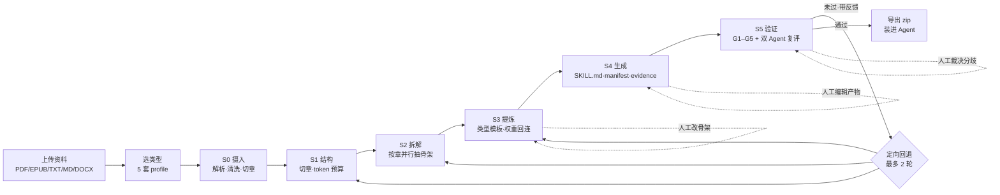
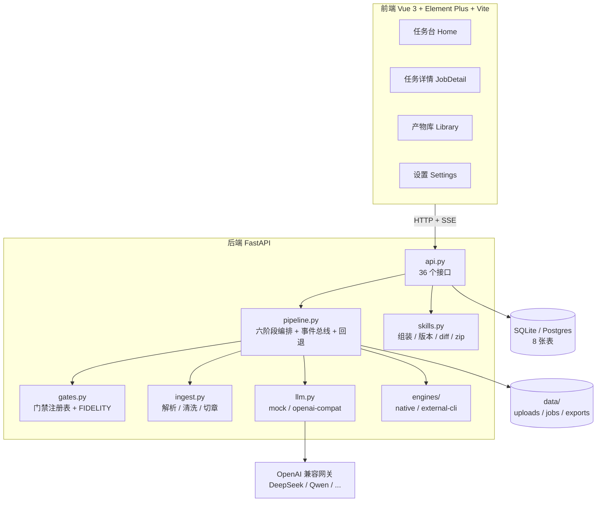

# SkillForge · 知识蒸馏工坊

> 2026-11-09 / v1.4 更新：账号/逐用户配额/审计、批量队列、模板市场及三页截图回归已交付；Postgres 16.4 真库检查已通过。真实模型调用按用户要求暂缓，Docker 真构建仍受本机 WSL2/虚拟化条件阻塞。最新命令与验收证据见 [验证记录](./verification/README.md)。

**把一本书 / 一套思维方式 / 一门课，蒸馏成一个能被 Agent 直接调用的 `SKILL.md`。**


```
上传资料 → 选类型 → 六阶段流水线 → 五道门禁 + 双 Agent 复评 → 导出可安装的 Skill
```

不是摘要，不是思维导图。产物是一份带 `when_to_use` 的 `SKILL.md`，装进 Claude Code 或其他支持 Agent Skills 的运行时后，**遇到合适场景会自动被调用**。每一条结论都能翻回原文，找不到依据就过不了门禁。

> 本项目为**可本地使用的工具**：默认离线 mock 引擎，零 API Key 即可跑通全链路；接真实模型只需在设置页填三个字段。

> 本文件是 GitHub 仓库 README 的源稿（存放于 `docs/`）。文档链接使用仓库根相对路径 `/docs/...`，因此放在 `docs/` 或仓库根目录都能正常跳转。

---

## 目录

- [为什么不是"AI 总结一本书"](#为什么不是ai-总结一本书)
- [功能特性](#功能特性)
- [工作流程](#工作流程)
- [快速开始](#快速开始)
- [五种蒸馏类型](#五种蒸馏类型)
- [六阶段与五道门禁](#六阶段与五道门禁)
- [产物结构](#产物结构)
- [技术架构](#技术架构)
- [主要 HTTP 接口](#主要-http-接口)
- [测试](#测试)
- [配置](#配置)
- [部署](#部署)
- [文档](#文档)
- [已知边界](#已知边界)
- [演进路线](#演进路线)
- [参与贡献](#参与贡献)
- [License](#license)

---

## 为什么不是"AI 总结一本书"

| | 通用总结工具 | SkillForge |
|---|---|---|
| 产物 | 一篇摘要 | `SKILL.md` + 框架卡 + 证据索引，可被 Agent 按 `when_to_use` 自动调用 |
| 类型 | 一套模板打天下 | 5 套类型路由，抽取目标、产物结构、门禁权重全部不同 |
| 可信度 | 无法校验 | 每条结论带原文 locator，G2 门禁用**字符串比对**核验，不靠模型自评 |
| 质量 | 生成完就结束 | 5 道门禁未通过会**定向回退重跑**，最多 2 轮 |
| 过程 | 黑盒 | 阶段时间轴 + 实时日志 + 中间产物可点开，骨架可人工编辑 |
| 干预 | 无 | 选类型 / 改骨架 / 改产物 / 裁决分歧，四个介入点 |

设计上的一条硬原则：**能用规则判的，绝不交给模型自评。** G1/G2/G3 是纯代码判定，只有 G4/G5 用 LLM，且评分维度是结构化的。

---

## 功能特性

- **五种类型路由** —— 类型不是标签，是参数集：`book` / `thinking` / `person` / `course` / `framework`，各自的抽取目标、章节模板、门禁侧重权重都不同。
- **六阶段流水线** —— 摄入 → 结构 → 拆解 → 提炼 → 生成 → 验证，S2 按章并行，长书不会被截断。
- **五道质量门禁** —— 完整性、锚点可溯、一致性、生成力、谦逊度；未过带反馈回退，最多 2 轮。
- **双 Agent 复评（FIDELITY）** —— 审校 Agent 独立读原文，逐条标 `grounded / ungrounded / biased`，分歧进人工裁决队列。
- **人在环** —— 骨架可改主张、调权重（0.1–5.0）、合并、增章；产物可就地编辑；所有保存都生成新版本。
- **版本可追** —— 每次保存生成 `v{n}` 快照，支持行级 diff 与回滚；回滚也生成新版本，不抹历史。
- **断点续跑** —— 服务重启后按**落盘产物**推断起点（不信数据库状态），`auto` 自动续跑 / `manual` 等人工确认。
- **可选访问控制** —— 单令牌 + 每日配额，支持 `X-API-Token` / `Bearer` / `?token=`（SSE 与下载）。
- **可切换存储** —— 默认 SQLite（WAL），设 `SKILLFORGE_DB_URL` 即切 Postgres，代码不分叉。
- **外部引擎协议** —— 任意蒸馏项目只要按约定产出 `SKILL.md`，填个命令就能挂进来，无需改代码。
- **零依赖可视化** —— Mermaid 子集自实现（`src/lib/mermaid.js`），不引第三方运行时。

---

## 工作流程



人工可介入的四个位置：**上传前选类型 → 骨架页改主张/权重/增删章 → 产物页直接编辑 → 分歧队列裁决**。

---

## 快速开始

### Windows

```bash
cd skillforge

python -m venv backend/.venv
backend/.venv/Scripts/python.exe -m pip install -r backend/requirements.txt

cd frontend && npm install && npm run build && cd ..

backend/.venv/Scripts/python.exe backend/run.py
```

### macOS / Linux

```bash
cd skillforge
python3 -m venv backend/.venv
backend/.venv/bin/pip install -r backend/requirements.txt
(cd frontend && npm install && npm run build)
backend/.venv/bin/python backend/run.py
```

打开 <http://127.0.0.1:8787>。健康检查：

```bash
curl http://127.0.0.1:8787/api/health
# {"ok":true,"provider":"mock","engine":"native","auth":false,"version":"1.4.0"}
```

### Docker

```bash
docker compose up -d --build                                  # http://localhost:8787，数据在 ./data
docker compose -f docker-compose.yml -f docker-compose.postgres.yml up -d --build   # 换 Postgres
```

镜像内已完成三件事：前端产物落到后端真正查找的 `frontend/dist`、容器内监听 `0.0.0.0`、内置 `HEALTHCHECK` 打 `/api/health`。

### 零配置体验

首页 →「内置示例」→ 选任意一份 → 准备资料 → 开始蒸馏。
默认 **mock 引擎**，不需要 API Key，离线就能跑完六阶段 + 五门禁 + 导出。

### 开发模式

```bash
# 终端 1
backend/.venv/Scripts/python.exe backend/run.py        # :8787

# 终端 2
cd frontend && npm run dev                             # :5173，/api 已代理到 8787
```

---

## 五种蒸馏类型

| 类型 | 抽取什么 | 产物重心 | 门禁侧重 |
|---|---|---|---|
| 📖 `book` 书本 | 章节框架、论证链、可执行方法、反例 | 框架卡 + 决策流程 | G2, G4 |
| 🧠 `thinking` 思维方式 | 信念的形成故事、真实决策、失败教训、**内在矛盾** | 认知上下文 | G2, G3, G5 |
| 👤 `person` 人物思想 | 跨作品恒定的判断准则、价值排序、观点演变（**至少 2 份资料**） | 人物认知卡 | G2, G3 |
| 🎓 `course` 课程资料 | 知识点、依赖关系、易错点、练习路径 | 知识地图 + 依赖图 + 学习路径 | — |
| 🧩 `framework` 单一框架 | 步骤、输入输出、适用前提、失效场景 | 流程图 + 失效清单 | — |

`person` 类型单源会被接口拒绝（`400`）——只有跨来源复现的主张，才算"恒定准则"。

类型定义在 `backend/app/profiles/*.yaml`，`gate_focus` 指定的门禁按 **2.0 权重**计入总分。

---

## 六阶段与五道门禁

| 阶段 | 做什么 |
|---|---|
| **S0 摄入** | 解析 PDF/EPUB/MD/TXT/DOCX，清洗页眉页脚、修复断行、识别章节 |
| **S1 结构** | 章节切分 + token 预算切片（单片 ≤ 5000 字） |
| **S2 拆解** | 蜂群并行：每章一个 Agent 抽骨架，跨章合并重复条目（**主张对立的保留**） |
| **S3 提炼** | 按类型模板提炼；回连人工权重，补回被截断的人工条目 |
| **S4 生成** | 组装 `SKILL.md` + `manifest` + `evidence`，写 `versions/v{n}` 快照 |
| **S5 验证** | 5 道门禁 + 双 Agent 交叉复评，不过则定向回退 |

| 门禁 | 判据 | 判定方式 | 失败回退到 |
|---|---|---|---|
| **G1 完整性** | 章节覆盖率 ≥ 95% | 规则 | S1 |
| **G2 锚点可溯** | 无原文依据的条目 ≤ 5% | **规则（字符串比对）** | S3 |
| **G3 一致性** | 同一概念冲突率 ≤ 10% | 规则（相似度） | S2 |
| **G4 生成力** | 3 个**书外新场景**能否给出可执行指引 | LLM + 结构化评分 | S4 |
| **G5 谦逊度** | 3 个超纲问题是否声明边界而非编造 | LLM + 结构检查 | S4 |

**FIDELITY 双 Agent**：审校 Agent 独立读原文，按章分批（不是只读前 1.2 万字），逐条标注 `grounded / ungrounded / biased`。含绝对化表述但原文未如此断言的，判 `biased`。分歧项进「裁决」标签页，人工确认。

---

## 产物结构

```
<slug>/
├── SKILL.md              # frontmatter(name/description/when_to_use) + 正文
├── manifest.json         # 来源、类型、模型、门禁得分、权重、耗时、可溯源
├── frames/               # 框架卡（book 类型核心产出）
├── evidence/index.json   # 每条结论 → 原文 locator
├── tests/probes.json     # G4 用过的书外 probe，可复跑
└── versions/v{n}/        # 每个版本的 SKILL.md + manifest + meta（diff / 回滚用）
```

安装：

```bash
unzip <slug>.zip -d ~/.claude/skills/
```

zip 内是 `<slug>/...`，**版本历史不入包**，保持可安装结构干净。装好后 Agent 依据 `when_to_use` 自动判断调用时机。

---

## 技术架构



| 层 | 技术 |
|---|---|
| 后端 | Python 3.10+、FastAPI、Uvicorn、SQLModel、PyYAML、httpx |
| 解析 | pypdf、ebooklib、beautifulsoup4；DOCX 走 zipfile + XML 正则清洗（不引 python-docx） |
| 存储 | SQLite（WAL + busy_timeout）默认；`SKILLFORGE_DB_URL` 切 Postgres 16 |
| 前端 | Vue 3.5、Vue Router 4、Element Plus 2.8、Vite 5 |
| 实时 | Server-Sent Events（事件总线 + 落库日志，刷新不丢） |
| 部署 | `python backend/run.py` / Docker Compose / Nginx 反代 |

---

## 主要 HTTP 接口

| 方法 | 路径 | 说明 |
|---|---|---|
| GET | `/api/health` | 健康检查（免鉴权） |
| GET | `/api/profiles` | 5 套类型元信息 |
| GET | `/api/engines` | 引擎列表（含可用性与不可用原因） |
| POST | `/api/engines/test` | 外部引擎自检（真跑一次，返回退出码与日志） |
| POST | `/api/sources` | 上传文件或粘贴文本（≤ 20MB） |
| POST | `/api/sources/sample/{key}` | 载入内置示例 |
| POST | `/api/jobs` | 创建蒸馏任务（`source_ids` 可传多份） |
| GET | `/api/jobs` | 任务列表（`limit` 上限 500） |
| GET | `/api/jobs/{id}` | 任务详情（阶段/门禁/分歧/版本/成本/产物） |
| GET | `/api/jobs/{id}/stream` | SSE 实时进度与日志 |
| POST | `/api/jobs/{id}/cancel` | 取消（仅 pending/running/interrupted） |
| POST | `/api/jobs/{id}/rerun` | 从指定阶段带反馈重跑 |
| POST | `/api/jobs/{id}/resume` | 断点续跑（按落盘产物推断起点） |
| POST | `/api/jobs/{id}/verify` | 只重跑门禁复检 |
| PUT | `/api/jobs/{id}/outline` | 保存人工修订的骨架 |
| GET/PUT | `/api/jobs/{id}/skill_md` | 读取 / 就地编辑产物（生成新版本） |
| POST | `/api/disputes/{id}/resolve` | 裁决双 Agent 分歧 |
| GET | `/api/skills` | 产物库（`q` / `skill_type` / `tag`） |
| GET | `/api/skills/{id}/versions` | 版本列表 |
| GET | `/api/skills/{id}/diff?a=&b=` | 行级 diff（缺失版本 404，不伪造差异） |
| POST | `/api/skills/{id}/rollback` | 回滚到指定版本（生成新版本） |
| GET | `/api/skills/{id}/download` | 下载 zip |
| GET | `/api/usage` | 当日任务数与配额余量 |
| GET | `/api/system/recovery` | 最近一次启动恢复结果 |

完整交互文档：<http://127.0.0.1:8787/docs>

---

## 测试

```bash
backend/.venv/Scripts/python.exe scripts/run_tests.py            # 一条命令跑八套（本轮约 50s）
backend/.venv/Scripts/python.exe scripts/run_tests.py --only units,smoke
```

`run_tests.py` 自动挑空闲端口、用**临时数据目录**起隔离实例、跑完清理——不会把测试任务混进演示库，也不要求先手动起服务。

| 套件 | 脚本 | 覆盖 |
|---|---|---|
| units | `test_units.py` | 跨章去重（含"主张冲突不合并"）、权重回连与人工条目补回、排序稳定性、门禁加权总分、diff 结构（含缺失版本）、DB URL 归一化、断点推断、标题抽取（引号不被截半） |
| gates | `test_gate_contracts.py` | G4 可执行/空泛对照、G5 诚实/编造对照、五种模型 JSON 契约与三种错误响应 |
| smoke | `smoke.py` | 五种类型端到端、骨架编辑、版本 diff/回滚/复检、多源人物思想、外部引擎、产物库检索、成本面板、取消（运行中/已完成/重复）、续跑、鉴权/配额、设置与入参守卫、格式解析 |
| formats | `test_formats.py` | 真实 PDF / EPUB / DOCX 各抽 3 章 |
| recovery | `test_recovery.py` | 独立数据目录起真服务 → 硬杀 → 重启，`auto` 自动续跑与 `manual` 人工续跑，批次成员重启不丢 |
| container | `check_container.py` | 前端产物路径、`0.0.0.0` 监听、HEALTHCHECK、卷与端口、Postgres DSN、`compose config` |
| browser | `test_browser.py` | 首页/详情/设置截图与基线比对、登录、批量与模板交互、JS 错误与 5xx 计数 |
| product | `test_product.py` | 账号初始化、越权读写拒绝、并发配额、同名产物并发下载、模板快照、审计脱敏、登出作废 |

八套全部通过；逐条通过记录见 [full-tests.log](./verification/full-tests.log)，截图差异见 [images/actual/report.json](./images/actual/report.json)。格式测试需额外依赖：


```bash
backend/.venv/Scripts/python.exe -m pip install -r backend/requirements-dev.txt
```

---

## 配置

### 环境变量

| 变量 | 默认 | 说明 |
|---|---|---|
| `SKILLFORGE_HOST` | `127.0.0.1` | 监听地址；容器内必须 `0.0.0.0` |
| `SKILLFORGE_PORT` | `8787` | 监听端口 |
| `SKILLFORGE_DATA` | `skillforge/data` | 数据目录（库、上传、产物、设置） |
| `SKILLFORGE_DB_URL` | 空（SQLite） | 外部数据库；`postgres://` 自动补 `+psycopg` |

### 接真实模型

设置页把 Provider 从 `mock` 改成 `openai-compat`，填 Base URL / API Key / 模型名即可（DeepSeek、Qwen、任意 OpenAI 兼容网关）。

`审校模型` 建议与生成模型**异构**，FIDELITY 双 Agent 复评才有意义。

也可直接改 `data/settings.json`。所有设置在落盘前校验（provider 枚举、阈值 0–1、并发 1–16、配额非负等），非法值 `400` 且不污染已保存配置。

### 访问控制（可选，默认关闭）

| 项 | 说明 |
|---|---|
| 访问令牌 | 打开后除 `/api/health` 外全部要求令牌；`X-API-Token` / `Bearer` / `?token=` |
| 每日配额 | `0` 不限；超出 `429` |
| 恢复策略 | `auto` 自动续跑 / `manual` 标记「已中断」 |

开启前必须先设置令牌，否则后端 `400` 拒绝——防止把自己锁在门外。

---

## 部署

| 形态 | 命令 | 说明 |
|---|---|---|
| 本机 | `python backend/run.py` | 最快，适合试用 |
| Docker | `docker compose up -d --build` | 数据挂载 `./data`，自带健康检查 |
| Docker + Postgres | 叠加 `docker-compose.postgres.yml` | 多人并发 / 多副本 |
| 反向代理 | Nginx + HTTPS | **SSE 需 `proxy_buffering off`**，`proxy_read_timeout 3600s` |

详细的搭建、备份、升级、排障步骤见 [docs/搭建操作流程.md](/docs/搭建操作流程.md)。

---

## 文档

| 文档 | 内容 |
|---|---|
| [功能使用说明](/docs/功能使用说明.md) | 界面导览、五步流程、门禁解读、四个干预点、FAQ |
| [搭建操作流程](/docs/搭建操作流程.md) | 四种部署形态、配置总表、Nginx、备份升级、验收清单、排障 |
| [源码编译环境搭建](/docs/源码编译环境搭建.md) | 工具链、venv、前端构建、断点调试、测试、扩展点、常见编译错误 |
| [公众号宣传文案](/docs/公众号宣传文案.md) | 对外介绍稿、配图与排版建议 |

---

## v1.4 新增功能与验收

账号页提供管理员初始化、普通用户管理、逐用户配额和操作审计。启用账号后以登录会话访问，普通用户的资料、任务、产物、下载和裁决均隔离；历史资料由管理员管理。

「批量与模板」支持一次提交 1–50 个持久化任务、最多 2 项运行、批次进度与取消；模板市场提供五种内置模板及私有/公开模板的创建、版本编辑、搜索、复制和复用。市场限当前实例，调度限单后端进程。

八套隔离回归、Postgres 16.4 真库迁移和 CRUD/并发检查、首页/详情/设置三张截图比较均已通过。浏览器检查含登录、退出、批量、模板和门禁复检，未出现 JS 错误或 HTTP 5xx。证据见 [验证记录](./verification/README.md)。

## 已知边界与剩余验收

- 真实模型接入和验收脚本已实现；用户本轮要求先留配置和入口，真实质量实验暂缓。
- Docker 真构建受本机 WSL2/虚拟化环境阻塞，静态容器检查通过不等于镜像已运行。
- Postgres 真库已验证，但未验证 Docker 中运行或多副本分布式调度。
- 截图固定视口、浏览器和字体环境，并遮罩动态字段；其他尺寸/平台需另行审核基线。
- 未标前置关系的课程依赖图仍为启发式推断，保留需人工复核的标记。

---

## 参与贡献

1. Fork 并新建分支：`feat/xxx` 或 `fix/xxx`
2. 本地跑通：`scripts/run_tests.py` 全绿 + `npm run build` 通过
3. 改接口 → 在 `scripts/smoke.py` 补断言；改门禁算法 → 在 `test_units.py` 补纯函数用例
4. 提交 PR，说明"改了什么 / 为什么 / 怎么验证"

代码约定：

- 入参先校验再落盘，非法值 `400` 而不是静默降级；
- 错误要显式抛出并带可读原因，不吞异常；
- 版本号只改 `backend/app/config.py` 的 `APP_VERSION`；
- 前端请求统一走 `src/api.js`，不在组件里裸写 `fetch`。

---

## License

仓库当前**未附带 LICENSE 文件**。在补充之前，默认保留所有权利（All rights reserved）。

如果你打算开源分发，建议先添加 MIT 或 Apache-2.0 许可证，并在 README 顶部同步 badge。

---

## English Summary

**SkillForge** distills a book, a thinking style, or a course into an installable Agent Skill (`SKILL.md`) instead of yet another summary.

Six-stage pipeline (ingest → structure → decompose → distill → compose → verify) with five machine-checked gates. G1–G3 are rule-based — anchors are verified by **literal string matching against the source**, not by asking the model to grade itself. Failed gates trigger targeted rollback with feedback (max 2 rounds). Human-in-the-loop at four points: type selection, outline editing with weights, direct artifact editing, and dispute adjudication. Every save creates a new version; diffs and rollbacks are supported.

Runs fully offline with a mock LLM — no API key needed. Swap in any OpenAI-compatible endpoint from the settings page. Python 3.10+ / Node 18+, SQLite by default, Postgres optional.

Docs are in Chinese: [usage](/docs/功能使用说明.md) · [deployment](/docs/搭建操作流程.md) · [build from source](/docs/源码编译环境搭建.md).

